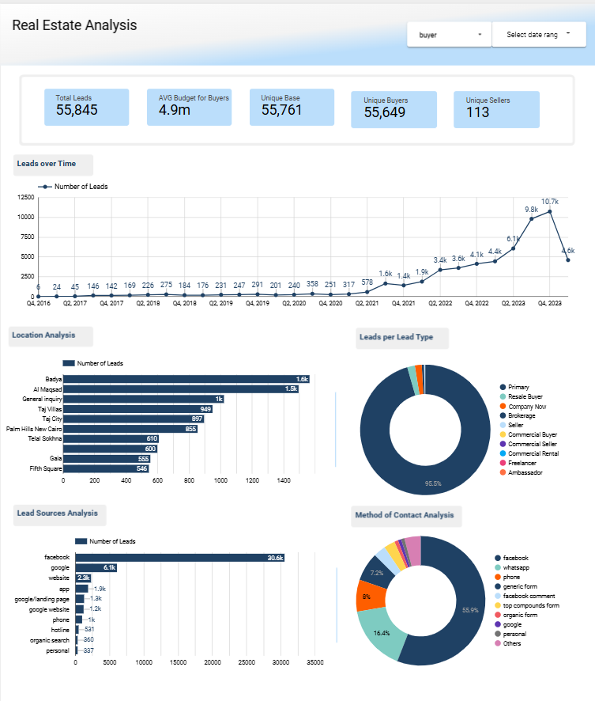
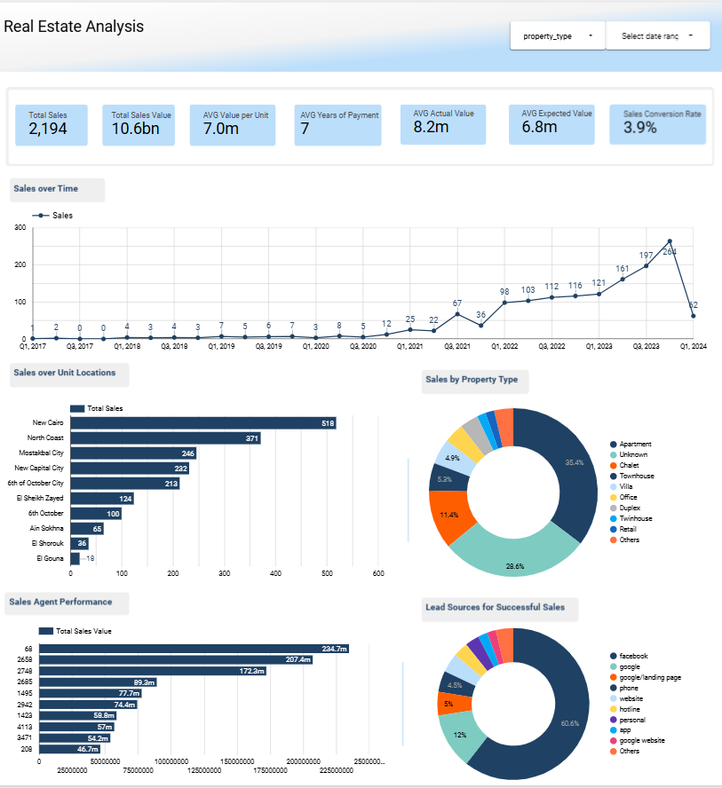

# Real Estate Leads & Sales Analysis

End-to-end analytics case study for a real estate marketplace app (2024): data cleaning in Python, exploratory SQL, a Looker Studio dashboard and a slide deck of findings.

## Business questions
- How are leads distributed across lead types, sources and locations?
- What is the lead-to-sale conversion rate, and how does it vary by lead type?
- Which property types, locations and sales agents drive the most sales value?
- How far do expected deal values differ from actual ones?

## Contents
| Path | What it is |
|---|---|
| `notebooks/real_estate_leads_cleaning.ipynb` | Python (pandas) cleaning: de-duplication, type casting, null handling, joins with lookup tables |
| `sql/lead_sales_analysis.sql` | PostgreSQL queries: conversion rates, top sources/locations, agent ranking with window functions |
| `data/leads_sample.csv` | 500-row sample of the cleaned leads table (full dataset not published) |
| `slides/real_estate_data_analysis_case.pptx` | Presentation of findings |
| Dashboard | [Looker Studio report](https://datastudio.google.com/reporting/43368c37-3ca3-4a43-887b-22ee71a827c6) (screenshots below) |

## Dashboard

**Leads analysis**: lead volume over time, top locations, lead types, sources and contact methods.

**Sales analysis**: sales and value over time, unit locations, property types, agent performance and conversion rate.

## Tools
Python (pandas, NumPy, Matplotlib, Seaborn), PostgreSQL, Looker Studio, Canva.

## Note
The original data belongs to the company that issued the case study and is not included. Company names have been removed from this repository.
